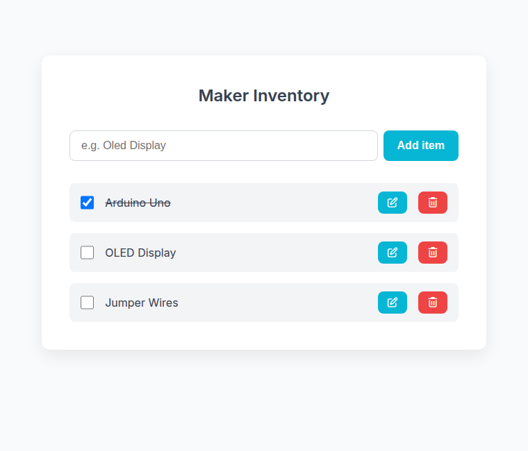

# Maker Inventory

A small jQuery app for keeping a list of maker supplies, such as boards, displays and jumper wires. Add a name, edit it, mark it complete or delete it.

<p align="center">
  
</p>

## Preview locally

Use Python 3 to serve the repository:

```sh
git clone https://github.com/SuhanVerse/m-inv.git
cd m-inv
python3 -m http.server 8000 --bind 127.0.0.1
```

Open `http://127.0.0.1:8000`. There is no npm installation, build step or backend setup. Internet access is needed for jQuery 3.7.1, Font Awesome 7.0.1 and the Google Fonts stylesheet loaded by the page.

## Storage and editing

Lists are stored as JSON in the current browser's localStorage under `Inventory-List`. They survive a reload on the same origin. They do not sync between devices or different hostnames/ports, and clearing site data removes them. Storage errors or manually corrupted saved JSON are not currently recovered automatically.

The app starts with the saved list, or an empty list. The example array in `js/data.js` is not used to seed it. Editing loads the existing name into the form and changes the submit button to **Update**. Names containing quotes or HTML-like text stay literal text.

`js/app.js` handles state and storage; `js/form.js` builds the form; `js/items.js` and `js/single-item.js` build the list. This is a name-and-completion exercise: it does not track stock quantities, locations, lending or accounts.

See [tests/README.md](tests/README.md) for the optional browser regression check. For related list exercises, see [Grocery Bud with jQuery](https://github.com/SuhanVerse/crud_jquery) and the [React version](https://github.com/SuhanVerse/CRUD_REACT).

## License

[GNU GPL version 3](LICENSE).
